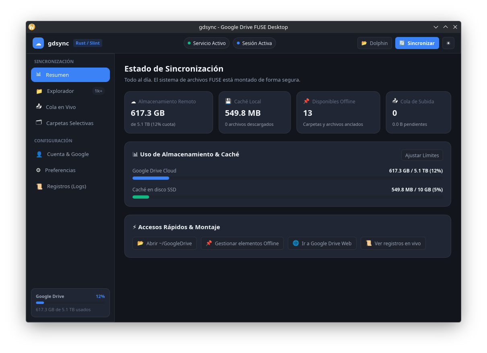

# gdsync

Cliente híbrido y bidireccional de **Google Drive para Linux** escrito 100% en **Rust** (con integración nativa en KDE Plasma / Dolphin y compatible con GNOME y demás entornos de escritorio).

<p align="center">
  
</p>

Permite visualizar y gestionar todo tu almacenamiento en la nube directamente desde tu gestor de archivos (por defecto en `~/GoogleDrive` o la ruta que elijas):

- **Modo híbrido bajo demanda (FUSE 3):** Navegá por todo tu Drive al instante. Los archivos ocupan 0 bytes locales hasta que decidís abrirlos.
- **Sincronización bidireccional:** Creá, editá, renombrá o enviá archivos a la papelera desde tu gestor de archivos local. Las modificaciones se sincronizan automáticamente con la nube mediante una cola persistente en SQLite.
- **Disponible sin conexión (Pinning / Offline):** Marcá archivos o carpetas para tenerlos siempre disponibles offline con un clic derecho en Dolphin, desde la interfaz gráfica o mediante CLI.
- **Sincronización selectiva:** Elegí si querés sincronizar toda tu unidad o únicamente las carpetas que te interesan para ahorrar ancho de banda y espacio de metadatos.
- **Integración con KDE Dolphin:** Menú contextual integrado (*ServiceMenu*) para anclar archivos, liberar espacio, abrir en Drive Web y copiar enlaces compartibles con un solo clic.
- **Interfaz gráfica moderna nativa (Rust + Slint):** Panel de control completo con monitor de cuota, explorador remoto integrado, visor de cola en vivo, gestor de sincronización selectiva, visor de logs en tiempo real, selector de temas y soporte para bandeja del sistema (*System Tray*).
- **Google Docs / Sheets / Slides:** Se integran como archivos `.desktop` nativos que abren el documento en tu navegador al hacer doble clic.

---

## Requisitos

- **Linux** (probado y optimizado para Ubuntu, Debian, Fedora, Arch con KDE Plasma 5/6, GNOME, etc.).
- **fuse3** (`fusermount3`).
- **Rust y Cargo** (1.75+ para compilar el workspace).

---

## 1. Configuración de credenciales de Google (una sola vez)

1. Ingresá a la [Consola de Google Cloud](https://console.cloud.google.com/) y creá un proyecto (ej. `gdsync`).
2. En **APIs y servicios → Biblioteca**, buscá y habilitá **Google Drive API**.
3. En **APIs y servicios → Pantalla de consentimiento de OAuth**:
   - Elegí tipo **Externo**, completá nombre de app y correo de contacto.
   - En **Usuarios de prueba**, agregá tu cuenta de Google (correo @gmail.com).
4. En **Credenciales → Crear credenciales → ID de cliente de OAuth**:
   - Tipo de aplicación: **App de escritorio**.
   - Descargá el archivo JSON (`client_secret_*.json`) o copiá tu **Client ID** y **Client Secret**.

> 💡 **Tip:** La propia aplicación incluye una **Guía interactiva paso a paso** en la pestaña *Cuenta y Conexión* con enlaces directos para facilitarte este proceso en menos de 2 minutos.

---

## 2. Instalación rápida

Podés instalar automáticamente los binarios nativos, el menú de Dolphin, el lanzador de escritorio y el servicio systemd ejecutando:

```bash
git clone https://github.com/tiago-pujia/gdsync.git
cd gdsync
./install.sh
```

El instalador compilará e instalará en tu sistema (`~/.local/bin` o `/usr/local/bin` con `sudo`):

- `gdsync`: Herramienta de línea de comandos (CLI).
- `gdsyncd`: Servicio daemon en segundo plano (FUSE + sincronización).
- `gdsync-gui`: Interfaz gráfica de usuario nativa (Slint).

---

## 3. Uso y Primeros Pasos

### A. Iniciar sesión

Podés iniciar sesión de cualquiera de las siguientes formas:

1. **Desde la Interfaz Gráfica (Recomendado):**
   Abrí `gdsync gui`, andá a la pestaña **👤 Cuenta y Conexión** y hacé clic en **📄 Examinar archivo JSON...** para seleccionar tu `client_secret_*.json`. Presioná **Iniciar Sesión con Google** y autorizá la app en tu navegador.
2. **Pasando tu archivo JSON por terminal:**
   ```bash
   gdsync login ~/Descargas/client_secret_*.json
   ```
3. **De forma interactiva (detecta automáticamente el archivo en Descargas):**
   ```bash
   gdsync login
   ```
4. **O pasando Client ID y Secret manualmente:**
   ```bash
   gdsync login --client-id TU_CLIENT_ID --client-secret TU_CLIENT_SECRET
   ```

Se abrirá automáticamente tu navegador para autorizar la aplicación de forma segura mediante OAuth 2.0 PKCE.

### B. Iniciar el servicio y montar Drive

Podés iniciar el daemon directamente en la terminal:

```bash
gdsyncd
```

O iniciarlo como servicio en segundo plano con **systemd**:

```bash
systemctl --user daemon-reload
systemctl --user enable --now gdsyncd
```

Para revisar el estado o los registros:

```bash
gdsync status
journalctl --user -u gdsyncd -f
```

### C. Abrir la Interfaz Gráfica (GUI)

Podés abrir la aplicación desde el menú de inicio de tu sistema buscando `gdsync`, o mediante el comando:

```bash
gdsync gui
```

La GUI te permite:

- Ver el estado del servicio en vivo y montarlo / desmontarlo con un botón.
- Monitorear el espacio total de Google Drive y el tamaño ocupado por la caché local.
- Explorar tus archivos de Drive, anclarlos offline o copiar sus enlaces compartibles.
- Seleccionar carpetas específicas para sincronización selectiva con casillas de verificación.
- Monitorear la cola de subidas y reintentar transferencias pendientes.
- Ajustar la ruta de montaje local (`~/GoogleDrive` o cualquier otra carpeta) y límites de caché.
- Minimizarse en la bandeja del sistema (*System Tray*).

---

## 4. Integración con Dolphin (KDE)

Al hacer clic derecho sobre cualquier archivo o carpeta dentro de tu unidad montada, encontrarás el submenú **Google Drive (gdsync)** con las siguientes acciones:

- 📌 **Mantener siempre en este equipo (Disponible sin conexión):** Descarga el archivo de inmediato y garantiza que el algoritmo de limpieza de caché nunca lo elimine.
- ☁️ **Liberar espacio local (Solo en la nube):** Permite que el archivo pueda ser liberado de la caché local cuando sea necesario.
- 🌐 **Abrir en Google Drive (Web):** Abre el elemento directamente en la interfaz web de Drive en tu navegador predeterminado.
- 📋 **Copiar enlace para compartir:** Copia la URL de Google Drive directa al portapapeles.

---

## 5. Referencia de Comandos CLI

| Comando                          | Descripción                                                          |
| -------------------------------- | -------------------------------------------------------------------- |
| `gdsync login`                   | Inicia sesión con OAuth 2.0 PKCE                                     |
| `gdsync status`                  | Muestra el estado del daemon, cuota de Drive, caché y cola de subida |
| `gdsync ls [carpeta]`            | Lista elementos remotos directamente desde la API                    |
| `gdsync pin <ruta>`              | Marca un archivo o carpeta como disponible sin conexión              |
| `gdsync unpin <ruta>`            | Desmarca un archivo o carpeta del modo sin conexión                  |
| `gdsync open-web <ruta>`         | Abre el elemento local en la versión web de Google Drive             |
| `gdsync copy-link <ruta>`        | Copia el enlace web del elemento al portapapeles                     |
| `gdsync folder list-remote`      | Lista todas las carpetas remotas disponibles en tu Drive             |
| `gdsync folder list`             | Muestra las carpetas seleccionadas para sincronización               |
| `gdsync folder add <nombre>`     | Agrega una carpeta a la sincronización selectiva                     |
| `gdsync folder remove <nombre>`  | Quita una carpeta de la sincronización selectiva                     |
| `gdsync folder reset`            | Restablece la sincronización a toda la unidad (`root`)               |
| `gdsync config show`             | Muestra la configuración actual                                      |
| `gdsync config set-mount <path>` | Cambia el punto de montaje local                                     |
| `gdsync config set-cache <gb>`   | Configura el tamaño máximo de la caché local en GB                   |
| `gdsync config set-poll <seg>`   | Configura el intervalo de sondeo de cambios remotos                  |
| `gdsync gui`                     | Lanza la interfaz gráfica de usuario                                 |
| `gdsync autostart`               | Administra el inicio automático al iniciar sesión (GUI y daemon)     |
| `gdsync resync`                  | Limpia la base de datos local y la caché (con el daemon detenido)    |
| `gdsync logout`                  | Cierra la sesión activa y revoca las credenciales                    |

---

## 6. Dónde se guardan los datos

| Tipo de dato                 | Ubicación estándar                                                      |
| ---------------------------- | ----------------------------------------------------------------------- |
| Configuración y credenciales | `~/.config/gdsync/config.json` y `token.json` (permisos seguros `0600`) |
| Base de datos local (SQLite) | `~/.local/share/gdsync/state.db`                                        |
| Archivos cacheados           | `~/.cache/gdsync/blobs/`                                                |
| Menú contextual de Dolphin   | `~/.local/share/kio/servicemenus/gdsync.desktop`                        |
| Lanzador de escritorio       | `~/.local/share/applications/gdsync.desktop`                            |
| Servicio systemd             | `~/.config/systemd/user/gdsyncd.service`                                |

---

## 7. Desinstalación

Para desinstalar completamente el cliente y remover los accesos del sistema:

```bash
./uninstall.sh
```

---

## Licencia

Este proyecto está distribuido bajo la licencia [GPL-3.0](LICENSE).
